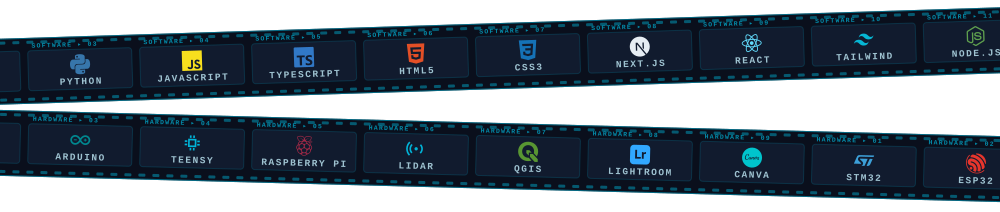

<!-- ====== HEADER ====== -->

  

  

  
  
  
  

---

### ⚡ About Me

I build systems where **hardware meets software**, from low-level firmware on microcontrollers to the tools that visualize what those machines see.

- 🔭 **Currently building** autonomous robots, including a ToF + IMU micromouse that navigates using Flood Fill
- 👁️ **Working on shared perception:** fusing camera feeds from multiple devices (Meta glasses, monocular cameras) into one map of the environment
- 🛰️ **Experience in** swarm drones, LiDAR-style mapping, and flood prediction with GIS / hydrological modeling in **QGIS**
- 🌱 **Learning** advanced sensor fusion, PID control optimization, and Next.js authentication
- 🤝 **Open to collaborate** on open-source embedded systems (STM32, ESP32), robotics, computer vision, and full-stack apps that work with hardware
- 🏆 **Ask me about** competitive robotics hardware, embedded C/C++, GIS mapping, or surviving hackathons

---

### 🛠️ Tech Stack

  

---

### 🚀 Featured Projects

<table>
  <tr>
    <td width="50%" valign="top">
      <h3>🐭 <a href="https://github.com/shnkdev404/tof_wala_maze_runner">Maze Runner (Micromouse)</a></h3>
      
Autonomous maze-solving bot using 3 ToF distance sensors with optional IMU/magnetometer fusion and Flood Fill navigation.

      
  

    </td>
    <td width="50%" valign="top">
      <h3>📡 <a href="https://github.com/shnkdev404/sentinel-net">sentinel-net</a></h3>
      
LiDAR-style 3D mapping from a single monocular camera, building a shared map of the environment.

      
  

    </td>
  </tr>
  <tr>
    <td width="50%" valign="top">
      <h3>🕶️ <a href="https://github.com/shnkdev404/Reycon-Meta-Glasses">Reycon Meta Glasses</a></h3>
      
Shared perception system that fuses live feeds from multiple Ray-Ban Meta glasses to power safety features.

      
  

    </td>
    <td width="50%" valign="top">
      <h3>🌊 <a href="https://github.com/shnkdev404/flood-mapping">flood-mapping</a></h3>
      
Predicts likely river paths and flood-affected areas using hydrological modeling and GIS analysis.

      
  

    </td>
  </tr>
  <tr>
    <td width="50%" valign="top">
      <h3>🩺 <a href="https://github.com/shnkdev404/Aidra">Aidra</a></h3>
      
Health management platform combining AI assistance with real doctor support.

      
  

    </td>
    <td width="50%" valign="top">
      <h3>🌐 <a href="https://github.com/shnkdev404/Portfolio_Shshank">Portfolio</a></h3>
      
My personal portfolio, built with Next.js and Tailwind CSS.

      
  

    </td>
  </tr>
</table>

---

### 📊 GitHub Stats

  
  

  

  

  

---

### 🐍 Contribution Snake

  <picture>
    <source media="(prefers-color-scheme: dark)" srcset="https://raw.githubusercontent.com/shnkdev404/shnkdev404/output/github-snake-dark.svg" />
    <source media="(prefers-color-scheme: light)" srcset="https://raw.githubusercontent.com/shnkdev404/shnkdev404/output/github-snake.svg" />
    
  </picture>

<!-- ====== FOOTER ====== -->

  

