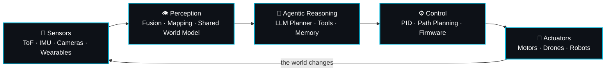

<!-- ====== HEADER ====== -->
<p align="center">
  
</p>

<p align="center">
  <a href="https://github.com/shnkdev404">
    
  </a>
</p>

<p align="center">
  <a href="https://linkedin.com/in/shshank-kumar-a639b1373"></a>
  <a href="mailto:kumarshshank75@gmail.com"></a>
  <a href="https://github.com/shnkdev404/Portfolio_Shshank"></a>
  <a href="https://instagram.com/_mobile.pixels_"></a>
</p>

<h3 align="center">
  <i>"Intelligence isn't real until it can move something."</i>
</h3>

---

### ⚡ `whoami`

```java
public final class Shshank implements PhysicalAI, AgenticSystem, HardwareEngineer {

    private final String mission =
        "Close the loop between AI and the physical world: sense → reason → act.";

    private final List<String> buildingNow = List.of(
        "Autonomous micromouse (ToF + IMU fusion, Flood Fill)",
        "Shared perception across multiple wearables & cameras",
        "Agents that plan with LLMs and execute on real hardware"
    );

    private final Map<String, String> layers = Map.of(
        "silicon",    "STM32 · ESP32 · Teensy · Raspberry Pi",
        "perception", "ToF · IMU · monocular vision · 3D mapping",
        "reasoning",  "agentic AI · planning · tool use",
        "software",   "Java · C/C++ · Python · TypeScript"
    );

    @Override
    public Action act(Observation world) {
        return plan(perceive(world)).verifyOnHardware();
    }
}
```

---

### 🧠 How I Think About Physical AI

Every project I build is a piece of one loop. Software agents are getting smart; **I'm interested in giving them a body.**



| Layer | Where you'll find it in my work |
|:--|:--|
| 🔌 **Sensing** | ToF + IMU array on the [Maze Runner](https://github.com/shnkdev404/tof_wala_maze_runner) |
| 👁️ **Perception** | Monocular 3D mapping in [sentinel-net](https://github.com/shnkdev404/sentinel-net), multi-device fusion in [Reycon](https://github.com/shnkdev404/Reycon-Meta-Glasses) |
| 🧠 **Reasoning** | Agentic AI experiments, plus AI-assisted care in [Aidra](https://github.com/shnkdev404/Aidra) |
| ⚙️ **Control** | Flood Fill navigation, PID tuning, bare-metal firmware |
| 🌍 **World scale** | Hydrological flood prediction in [flood-mapping](https://github.com/shnkdev404/flood-mapping) |

---

### 🚀 Featured Projects

<table>
  <tr>
    <td width="50%" valign="top">
      <h3>🐭 <a href="https://github.com/shnkdev404/tof_wala_maze_runner">Maze Runner</a></h3>
      <p>Autonomous micromouse with 3 ToF sensors, optional IMU/magnetometer fusion, and Flood Fill navigation. Sensing, mapping, and control on a single microcontroller.</p>
      <p>  </p>
    </td>
    <td width="50%" valign="top">
      <h3>📡 <a href="https://github.com/shnkdev404/sentinel-net">sentinel-net</a></h3>
      <p>LiDAR-style 3D mapping from a single monocular camera. Turns ordinary cameras into depth-aware sensors that build a shared map.</p>
      <p>  </p>
    </td>
  </tr>
  <tr>
    <td width="50%" valign="top">
      <h3>🕶️ <a href="https://github.com/shnkdev404/Reycon-Meta-Glasses">Reycon Meta Glasses</a></h3>
      <p>Shared perception that fuses live feeds from multiple Ray-Ban Meta glasses into one view of the world, powering real-time safety features.</p>
      <p>  </p>
    </td>
    <td width="50%" valign="top">
      <h3>🌊 <a href="https://github.com/shnkdev404/flood-mapping">flood-mapping</a></h3>
      <p>Predicts likely river paths and flood-affected regions with hydrological modeling and GIS analysis. Physical AI at the scale of a landscape.</p>
      <p>  </p>
    </td>
  </tr>
  <tr>
    <td width="50%" valign="top">
      <h3>🩺 <a href="https://github.com/shnkdev404/Aidra">Aidra</a></h3>
      <p>Health management platform pairing AI assistance with real doctor support, keeping a human in the loop where it matters.</p>
      <p>  </p>
    </td>
    <td width="50%" valign="top">
      <h3>🌐 <a href="https://github.com/shnkdev404/Portfolio_Shshank">Portfolio</a></h3>
      <p>My personal site, built with Next.js and Tailwind CSS. The long-form story behind these projects.</p>
      <p>  </p>
    </td>
  </tr>
</table>

---

### 🧭 Now · Next · Learning

| 🔨 Now | 🔭 Next | 📚 Learning |
|:--|:--|:--|
| Tuning the micromouse: faster Flood Fill, smoother PID | An LLM agent that plans missions and hands them to a real robot | Advanced sensor fusion (EKF and beyond) |
| Multi-device shared perception | One shared world model across robots, wearables & drones | Agentic AI patterns: tool use, memory, multi-agent coordination |
| Monocular 3D mapping | Swarm coordination driven by shared maps | Java for robust backends that talk to hardware |

---

### 🛠️ Toolbox

**Languages & Software**
<p>
  
</p>

**Hardware & Systems**
<p>
  
</p>
<p>
  
  
  
  
  
  
</p>

---

### 📐 Principles I Build By

> **1. Reality is the benchmark.** A model that works in simulation but not on the bench isn't finished.
>
> **2. Know every layer.** I want to understand the register, the algorithm, *and* the agent's prompt.
>
> **3. Perception is a team sport.** Machines see better together than alone.
>
> **4. Ship, then measure.** Hackathon speed, engineering discipline.

---

### 🏆 Ask Me About

`micromouse & competitive robotics` · `embedded C/C++ on STM32/ESP32` · `sensor fusion` · `monocular 3D mapping` · `agentic AI for robots` · `GIS & flood modeling` · `surviving hackathons`

---

<details>
<summary><b>📊 GitHub Stats</b> (click to expand)</summary>
<br/>

<p align="center">
  
  
</p>

<p align="center">
  
</p>

<p align="center">
  
</p>

</details>

---

### 🐍 Contribution Snake

<p align="center">
  <picture>
    <source media="(prefers-color-scheme: dark)" srcset="https://raw.githubusercontent.com/shnkdev404/shnkdev404/output/github-snake-dark.svg" />
    <source media="(prefers-color-scheme: light)" srcset="https://raw.githubusercontent.com/shnkdev404/shnkdev404/output/github-snake.svg" />
    
  </picture>
</p>

<p align="center">
  <b>Building something that moves, sees, or thinks? Let's talk.</b><br/>
  <a href="mailto:kumarshshank75@gmail.com">kumarshshank75@gmail.com</a>
</p>

<!-- ====== FOOTER ====== -->
<p align="center">
  
</p>
